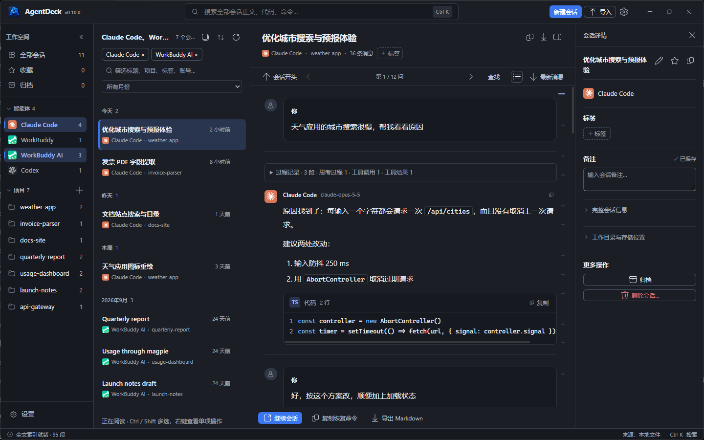

# AgentDeck

跨 Agent 的历史会话检索与恢复工作台。

统一索引 Claude Code、Claude Desktop、Codex、WorkBuddy 等多个 AI 编程智能体的历史会话，
做「找到当时的工作 → 看清做到哪一步 → 在正确工具和目录里继续」。


> 截图中的会话全部为演示数据。

## 定位

AgentDeck 将分散在不同智能体中的本地历史会话集中展示，帮助检索、阅读和继续工作。
默认只读访问上游存储，不上传会话；手动删除仅在预览确认、备份成功后修改原始记录。

## 下载与安装

Windows x64 版本从 [Releases](https://github.com/enpiaohj/agentdeck/releases) 下载：

- `AgentDeck-vX.Y.Z-win-x64.exe`：单文件绿色版，双击运行；需要系统已安装
  Microsoft Edge WebView2 Runtime（Windows 11 默认自带）。
- `AgentDeck-vX.Y.Z-win-x64.zip`：同一 EXE 加 CHANGELOG、`LICENSE`、`NOTICE.md`
  与 `THIRD-PARTY-NOTICES.txt`。
- `SHA256SUMS`：上述产物的校验值。

当前发布产物未做代码签名，Windows SmartScreen 可能提示未知发布者；请用 `SHA256SUMS`
校验后再运行。已安装的版本可在「设置 → 更新」检查并下载新版本（见下文「在线更新」）。

## 当前状态

**已发布 v0.12.0 — Windows 桌面工作台**（Wails v3 + React 18 + Fluent UI v9）。
各版本变化见 [CHANGELOG.md](CHANGELOG.md)，本机发布快照位于 `releases/vX.Y.Z/`。

v0.12.0 的重点：

- 删除会话新增「直接删除」：在「备份并删除」之外提供不保留备份的入口，需单独确认；失败时
  仍会自动回滚（见「删除会话」）
- 本地会话库新增「清理旧版本」：持续进行的会话会累积大量完整快照，现在可以预览后清理旧版本
  并回收空间，每个会话当前的版本始终保留
- 收藏、归档、标签、备注、改名只更新受影响的那几行，不再重新载入整个会话列表；归档与批量
  收藏成功后给出带「撤销」的提示，失败不再被静默吞掉
- 终端 PowerShell 默认选用最高可用版本（有 PowerShell 7+ 就用它）；已保存的选择不受影响
- 恢复 Codex 会话时，名称已经同步就不再重复启动 Codex 的 app-server
- 首次扫描显示已处理文件数，会话列表加载失败可重试，空列表提供「新建会话」入口，屏幕外的会话行
  不再参与渲染

此前版本：v0.11.0 三栏宽度全部可拖动、删除会话改为按会话备份；v0.10.0 读入 Claude Desktop 3.x
的数据目录与本机聊天缓存、新增 WorkBuddy AI 与在线更新。完整列表见 CHANGELOG。

## 功能

### 会话发现与阅读

- 自动发现本机各智能体的会话并建立索引，读取原生标题与正文；会话列表头部的刷新按钮
  （或 F5）重新扫描磁盘，同时更新列表、项目统计与全文索引
- 紧凑四栏工作台：导航、会话列表、阅读区、会话详情；左右面板可独立折叠，浅色 / 深色主题
- 会话默认定位最新一轮问答；长会话从真实末尾读取，不受开头预览上限遮挡
- **提问导航条**：有多次提问时，阅读区右侧显示一列短刻度，按非空用户正文段生成标记，
  位置按该段在全文中的分段序号成比例；两次提问之间分段越多，刻度间距越大。悬停显示
  「第 k / n 问」与摘要，点击跳转，当前所读的一问用主题色标出；相邻标记过近时合并，
  点击合并刻度跳到其中首问。刻度条平时淡显，可在阅读导航栏一键收起并记住偏好。
  顶部显示「第 k / n 问」，左右箭头跳到上一问 / 下一问
- 思考、工具调用 / 结果、上下文及大段 JSON 默认折叠；长代码按需展开，搜索命中自动展开对应内容
- Markdown 标题、列表、引用、表格、代码块与行内代码排版；会话可导出为 Markdown
- Codex 子 Agent 按已确认的主会话归组，默认折叠，可展开查看；会话计数不重复计入子会话
- Token 与成本统计（含逐模型明细）

### 搜索


- 顶栏直接输入全文搜索，结果与正文并排展示；Ctrl+K 聚焦、方向键选择、Enter 预览、Esc 返回列表
- 中文全文检索（SQLite FTS5 + bigram 预分词），两字中文词也能命中，并定位到正文中的那一段
- 阅读区内 Ctrl+F 查找当前会话

### 整理与筛选



- 侧栏只有一个滚动区：「全部会话 / 收藏 / 归档」固定在顶部、「设置」固定在底部，智能体与
  项目分区可折叠，标题滚动时吸顶；项目默认列出前 8 个，可「显示全部」
- 智能体 / 项目 / 收藏 / 归档默认单选（单击替换整个筛选），Ctrl+单击把该维度并入或移出当前筛选；
  智能体可 Ctrl+单击多选、Shift+单击按侧栏顺序连选、Ctrl+Shift+单击把一段并入已选，列表取
  并集，顶部每个智能体一个可移除的标签；「全部会话」清除全部筛选与搜索关键词
- 当前列表支持标题 / 项目 / 标签 / 账号与月份筛选、最近 / 最早活动排序，历史记录按日期与年月分组
- 导航侧栏、会话列表、会话详情栏都可拖动分隔条调整宽度：双击恢复自动宽度，方向键按 8px、
  Shift+方向键按 32px 微调；宽度会记住，且始终给正文区留出阅读空间
- 收藏 / 标签 / 备注 / 归档（保存在本地标注库，不改上游文件），项目维度聚合
- 会话列表采用桌面选择：单击单选、Ctrl 点击切换、Shift 连选、Ctrl+Shift 追加连选；Ctrl+A 全选
  当前筛选结果，Esc 清空选择；支持方向键与 Home / End
- 会话右键菜单支持打开、继续会话、收藏、归档、管理标签与备注、复制及 Markdown 导出；多选时
  支持批量整理与导出，Shift+F10 可用键盘打开菜单
- 归档、取消归档与批量收藏成功后会提示完成数量并提供「撤销」；批量中部分失败时单独报告失败
  数量。这些操作只更新受影响的行，不会重新载入整个列表
- 本机 WorkBuddy / WorkBuddy AI 会话若在各自数据库中标记为已删除、但文件仍在，仍会列出，
  以灰色状态图标标出并提供悬停说明；其他智能体及 WSL 来源暂不检测此状态

### 继续会话

- 复制恢复命令，或直接在终端中继续会话（仅对支持命令行恢复的智能体）
- 终端 PowerShell 可在设置中选择：自动（优先 PowerShell 7+，默认）、Windows PowerShell 5.1、
  PowerShell 7+ 或自定义可执行文件，并显示检测到的版本；已保存的选择保持不变
- Codex 会话在恢复前会同步 AgentDeck 里设置的名称；Codex 自己的索引里已经是同名时跳过同步，
  不再等待 Codex 的 app-server 启动
- 恢复参数（会话 ID、工作目录）按白名单校验后才交给终端

### 设置


- 九个分类：常规、外观、会话、终端、数据管理、备份与恢复、诊断、更新、快捷键；支持多关键词
  搜索，Ctrl+, 打开
- 开机启动和关闭时最小化到托盘均默认关闭（见下文「启动与系统托盘」）

## 支持的智能体与数据来源

AgentDeck 默认只读访问各智能体的本地存储。唯一例外是**用户显式发起的手动删除**
（见「删除会话」）：只有经过预览确认、且备份成功之后才会写入（「直接删除」在删除全部成功后
丢弃这份备份）。

| 智能体 | 存储位置 |
| --- | --- |
| Claude Code CLI | `~/.claude/projects/<编码目录>/*.jsonl` |
| Claude Desktop（Code / Cowork） | `%LOCALAPPDATA%\Claude-Data\claude_<pub>\{local-agent-mode-sessions,claude-code-sessions}\...\.claude\projects\`（3.x；2.x 在 `Packages\Claude_<pub>\LocalCache\Roaming\Claude`） |
| Claude Desktop（聊天缓存） | `%LOCALAPPDATA%\Claude-Data\claude_<pub>\IndexedDB\https_claude.ai_0.indexeddb.{leveldb,blob}` |
| Codex | `~/.codex/sessions/YYYY/MM/DD/rollout-*.jsonl` + `state_5.sqlite` |
| WorkBuddy / WorkBuddy AI（国际版） | `~/.workbuddy/projects/`、`~/.workbuddy-ai/projects/` 下的 `*.jsonl`；删除状态只读自各自的 `workbuddy.db` |
| OpenCode | `~/.local/share/opencode/opencode.db` |
| ZCode | `~/.zcode/cli/db/db.sqlite` |
| DeepSeek Harness (dsh) | `~/.dsh/sessions/<编码目录>/<会话>/session.v<N>.jsonl[.zstd]` |

此外还会发现 Hermes、Qoder / Qoder CN、Cursor、Cline、Grok、Kimi、Pi、Droid、Alma、CodeBuddy
等智能体的本地记录，以本机实际安装为准。

### Claude Desktop 的聊天与导入

Claude Desktop 读取本地 Code / Cowork 记录（含 MSIX 目录），以及 Desktop 本机缓存的普通聊天与
项目会话（来源显示「Desktop 聊天缓存」）：Desktop 不为云端聊天写本地记录，只有在
Desktop 里打开过的会话才缓存了正文。AgentDeck 只读这份缓存，副本存在导入目录旁的
`claude-desktop-cache/`；这类会话不能恢复或删除原始记录。

没打开过的会话与更早的聊天请使用顶部「导入」：从各 Claude 账号的「设置 → 隐私 → 导出数据」
下载 ZIP，或选择其中的 `conversations.json`。同一账号沿用同一名称；不同账号使用不同名称。
导入副本保存在索引库旁的 `imports/claude/`，原始文件不变，云端不会自动同步。当前导入文本与
思考内容，不包含附件文件本体、图片及部分工具内容，不能通过 CLI 恢复导入会话。

## 本地会话库、备份与数据位置

本地会话库默认位于 `%LOCALAPPDATA%\AgentDeck\library\history.db`，与可重建的
`index.db` 分开。启动或刷新后构建索引、打开正文、导出等读取会自动保存可解析内容；
新内容作为版本保留，没有过期时间和自动删除任务。保留库保存解析器读到的完整正文，
不沿用界面预览的截断上限；附件文件本体仍不在范围内。上游已丢失且从未读入的内容
无法补回。源记录消失后的本地副本保持原会话标识、收藏、标签和备注，不宣称可以原生恢复。
正文按 zstd 存放（小于 4 KiB 不压），内容与元数据都没变时不再重写；升级前留下的明文
正文可用「设置 → 数据管理 → 压缩会话库」重压一遍并回收文件空间，原始内容不变、
可重复执行。全文索引的 FTS 表只留一份分词结果（contentless），旧索引在首次打开时
就地重建该表，不重读会话文件。

会话持续进行时，每次读取到新内容都会保存一份完整快照，同一个会话可以累积上百个版本
（本机实测 1.8 GB 的库里有 1.2 GB 来自同一个活跃会话的 285 个版本）。「设置 → 数据管理 →
清理旧版本」让你指定每个会话保留最新几个版本（默认 5），先预览会清掉多少版本、释放多少
空间，勾选确认后才执行。每个会话当前使用的版本始终保留，阅读、搜索与导出不受影响；候选集的
计算与删除在同一个事务里，之后回收文件空间。这是本地会话库里唯一会删除版本的操作，被清理的
版本无法恢复——需要保险可先在「备份与恢复」创建完整备份。

「设置 → 数据管理」可查看库位置、会话数、版本数及保存错误；「设置 → 备份与恢复」可创建完整数据备份。
备份包含本地会话库全部版本、收藏 / 归档 / 标签 / 备注、导入历史及界面偏好；不包含原生
Agent 目录、账号凭据和附件文件，全文索引可重建。单个备份上限为 20,000 个数据文件、
解压后 4 GiB。恢复前校验格式、文件清单、SHA256 和数据库内容，并在本地会话库目录下的
`data-recovery/` 自动保存当前完整备份。恢复采用合并方式，保留现有正文及版本，同名会话
标注以备份为准，导入文件冲突时拒绝覆盖。每个数据库独立提交事务；异常时可能已补入部分
历史，但不会删除已有版本，界面会显示恢复前备份的位置。恢复后自动重新构建全文索引。

数据位置可在「设置 → 数据管理 → 存储位置」整体迁移到其他磁盘。选择的是「数据
放在哪个目录下」：数据根固定取所选目录下的 `AgentDeck\Data`（例如，选择 `D:\` 得到
`D:\AgentDeck\Data`，`D:\software` 得到 `D:\software\AgentDeck\Data`）；所选目录本身
就叫 `AgentDeck` 时只追加 `Data`，已经选到数据根本身时原样使用；只比末级目录名，不做
前缀匹配。确认之前界面即显示补全后的路径与目标现状——已存在且为空可直接使用，已存在且
非空则拒绝，不存在则迁移时创建。迁移对三个数据库取在线一致快照（`VACUUM INTO`），其余
数据文件逐个复制并校验 SHA-256，全部通过后才写入位置指针，重启后生效；旧位置的数据一律
保留，确认新位置运行正常后再用「清理旧位置数据」显式删除（预览清单绑定内容哈希，内容
变化则整批拒绝）。全文索引可重建，不参与复制，重启后按新位置重建。位置指针保存在
`%APPDATA%\AgentDeck\app-config.json`，该文件始终留在原地，迁移与清理都不会动它。

## 在线更新

「设置 → 更新」显示当前版本，可手动检查更新。启动后后台检查一次（同一版本每天最多一次，
可关闭「启动后自动检查」）。发现新版本后，点击「下载到本地」才会下载到数据目录的 `updates/`，
并按发布页的 `SHA256SUMS` 校验分发包与解压出的 exe；校验失败不保留半成品。程序**不会**自动
替换正在运行的 exe，也不会启动下载到的程序，由用户关闭程序后自行替换。

## 快捷键

| 操作 | 快捷键 |
| --- | --- |
| 搜索所有会话 | Ctrl + K |
| 刷新会话列表 | F5 |
| 新建会话 / 新建项目 | Ctrl + N / Ctrl + Shift + N |
| 打开设置 | Ctrl + , |
| 查找当前会话 | Ctrl + F（Enter / Shift + Enter 跳到下一 / 上一处） |
| 全选当前列表 / 清空选择 | Ctrl + A / Esc |
| 追加 / 取消选择、连续选择 | Ctrl + 单击、Shift + 单击、Ctrl + Shift + 单击 |
| 多选 / 连选智能体（侧栏） | Ctrl + 单击 / Shift + 单击 |
| 重命名 / 删除所选会话 | F2 / Delete（删除先显示确认窗口） |
| 打开操作菜单 | Shift + F10 / 菜单键 |
| 调整栏宽 | 拖动分隔条；聚焦后 ← / → 移 8px，Shift + ← / → 移 32px；双击恢复自动宽度 |
| 保存备注 | Ctrl + Enter |

完整列表见「设置 → 快捷键」。

## 启动与系统托盘

在「设置 → 常规 → 启动与退出」分别设置开机启动和关闭时最小化到托盘，两项默认关闭。
开机启动时主窗口保持隐藏；手动打开程序、单击托盘图标或选择「打开 AgentDeck」会显示窗口。
启用关闭到托盘后，使用托盘菜单「退出」结束应用；未启用时关闭窗口即退出。

开机启动使用当前用户的 Windows 启动注册项，记录启用时的程序绝对路径。建议将正式 EXE
放在固定目录后再启用；移动或更换 EXE 路径后，在新程序中关闭并重新开启开机启动以更新路径。
窗口关闭偏好保存在 `%APPDATA%\AgentDeck\app-config.json`，旧配置缺少新字段时均按关闭处理。

## 隐私与网络访问

- 会话正文、索引、标注与偏好全部保存在本机，不上传、不遥测、不需要账号。
- 不读取独立的账号凭据文件或 Cookie 存储。Desktop 聊天缓存功能只读扫描本机缓存，从中提取会话正文、
  列表元数据、账号标识与显示名，并读取本地授权文件夹映射以确定工作目录；不使用这些
  信息进行登录或认证。
- 当前应用从本机缓存与内置目录读取模型和定价信息，尚未接入模型目录的联网刷新入口。
- 检查更新时向 `https://api.github.com/repos/enpiaohj/agentdeck/releases/latest` 发起一次只读
  GET 请求，User-Agent 只含产品名与版本号；不发送会话、路径或账号信息。启动后的自动检查
  同一版本每天最多一次，结果缓存在数据目录的 `updates/check.json`；关闭「启动后自动检查」
  后不再发起该请求。下载只在用户点击「下载到本地」时发生。
- 更新包按发布页公布的 `SHA256SUMS` 校验完整性。项目未做代码签名，因此该校验只能说明
  文件与发布清单一致，不能证明发布者身份；替换 exe 由用户手动完成。
- 诊断界面显示本机扫描与读取错误，错误信息可能包含本机路径；分享诊断信息前请检查其中的个人信息。

## 删除会话

删除是**不可自动回滚**的破坏性操作，因此设计成四道闸：

1. **只对明确来源开放**：仅本机原生或永久保留的 Codex、Claude Code、Claude Desktop
   会话。WSL、网关、导入与聊天缓存来源一律拒绝并给出原因（在 WSL 里管理、副本不可原生恢复）。
2. **执行前重新校验**：预览会核对文件路径、大小与内容；源文件若在预览后发生变化，
   整批拒绝并要求重新预览。
3. **先备份再删**：删除前把原始文件与 AgentDeck 保留的全部版本写入
   `%LOCALAPPDATA%\AgentDeck\deletions\delete-*\`，备份失败则一个字节都不删。
   备份只含所选会话：原始文件逐个复制，保留版本与标注按会话复制成独立的小库，
   不复制整库，所以删除耗时与会话库大小无关（本机 1.7 GB 的库实测 41 毫秒）。
   多个来源中途失败时，已删的部分会回滚。
4. **不删目录**：只移除确认过的具体文件与索引条目，不递归删除目录。

删除时会同步处理相关会话索引；遇到无法识别的数据库结构时拒绝操作。
撤销仅在本次运行期间提供，磁盘上的备份长期保留。

### 直接删除

删除对话框里除了默认的「备份并删除」，还有一个折叠的「不保留备份，直接删除」。它面向
不希望在磁盘上继续留着这些会话私密副本的场景，因此需要先确认会话已结束，再单独勾选
「了解删除后无法恢复」。

它**不是跳过备份**：恢复备份仍然先写、先校验，因为删除中途失败时的自动回滚完全依赖它；预览、
来源限制、内容哈希校验、不删目录这几道闸一样不少。区别只在删除全部成功之后：备份文件会被
逐个删除（目录只用非递归方式收掉），不提供撤销，提示条里也不再出现恢复备份位置。
只会留下一个只含会话标识、不含内容的 `operation.json`，用来防止已删会话被其他来源重新收录。

## 架构

```
cmd/agentdeck/         命令行入口
cmd/agentdeck-desktop/ Wails 桌面入口
frontend/              React 桌面界面与生成的服务 bindings
internal/app/          桌面服务层与装配
internal/appconfig/    数据位置与终端设置的引导配置
internal/search/       中文全文索引与检索
internal/marks/        本地收藏、标签、备注与归档
internal/projects/     项目聚合与路径归一化
internal/sessions/     会话发现、解析、列表、恢复（核心）
internal/catalog/      模型目录与定价数据
internal/redact/       脱敏
internal/settings/     设置
internal/desktopdir/   Claude Desktop 目录发现（含 MSIX 打包路径与 3.x 新数据目录）
internal/claudecache/  Claude Desktop 本机聊天缓存（IndexedDB）只读解析
internal/claudehistory/ Claude 官方导出（JSON / ZIP）导入
internal/update/       在线更新检查、下载与校验
internal/provider/     最小 provider 替代（只读打开 + 基础定价）
tools/                 图标与第三方许可声明生成脚本
```

会话层不依赖任何桌面框架，可独立编译与测试。

## 构建

要求 Go 1.26.8 或更高。桌面构建另需 Node.js / npm、Wails CLI
`wails3`（与 `go.mod` 中的 `v3.0.0-beta.30` 对齐）、Task 和 PowerShell 7
（`pwsh`），运行时需要 WebView2。

命令行与 Go 编译检查：

```sh
go build ./...
go run ./cmd/agentdeck
```

Windows 桌面完整构建（生成 bindings → 构建前端 → 清理并同步资源 → 编译 exe）：

```powershell
task build
```

输出为 `bin/agentdeck-desktop.exe`。已有依赖与 bindings 时，可分步构建：

```powershell
Set-Location frontend
npm run build
Set-Location ..
pwsh -NoProfile -File frontend/scripts/sync-assets.ps1
go build -trimpath -tags production -ldflags "-H windowsgui -s -w" -o bin/agentdeck-desktop.exe ./cmd/agentdeck-desktop
```

资源同步会清空打包目录中的旧生成文件（只保留 `.gitkeep`），再复制 `frontend/dist`，
并校验两者的文件清单完全一致；只运行 `go build` 不会刷新前端。
`frontend/scripts/rebuild.ps1` 还会重启应用并截图。

验证命令：

前端定向测试：在 `frontend/` 运行 `npm test`（使用 Node.js 22 验证）。

```powershell
gofmt -l cmd internal
go vet ./...
go build ./...
go test ./... -count=1
```

## 已知限制

- 「直接删除」与「清理旧版本」都不可撤销；前者删除完成后不留备份，后者清掉的旧版本无法恢复。
- 上游智能体可能自动清理历史记录；
  AgentDeck 保留成功读取的本地副本，但无法补回首次读取前已删除的记录。
- Claude Desktop 会话无原生恢复入口；Desktop 聊天缓存只包含在 Desktop 里打开过的会话，
  其缓存格式属于 claude.ai 前端的内部结构，Desktop 升级后可能变化（读取失败会显示在诊断里）。
- 当前正式产物为未签名的 Windows x64 单文件 exe，尚无安装包。
- 原生窗口在不同 DPI 下尚未完整走查，macOS / Linux 尚未构建和运行验证。

## 待实现

- 生成新摘要、交接到其他 Agent
- 项目 / 文件 / 工具调用独立视图

## 许可

MIT。包含移植自 [magpie](https://github.com/yetone/magpie) 的代码
（MIT, Copyright (c) 2026 yetone）与 [Lobe Icons](https://github.com/lobehub/lobe-icons)
的图标（MIT, Copyright (c) 2023 LobeHub）。依赖许可文本见
[NOTICE.md](NOTICE.md) 与 [THIRD-PARTY-NOTICES.txt](THIRD-PARTY-NOTICES.txt)。
品牌名称与标识归各自权利人所有，本项目与这些产品没有隶属或赞助关系。
