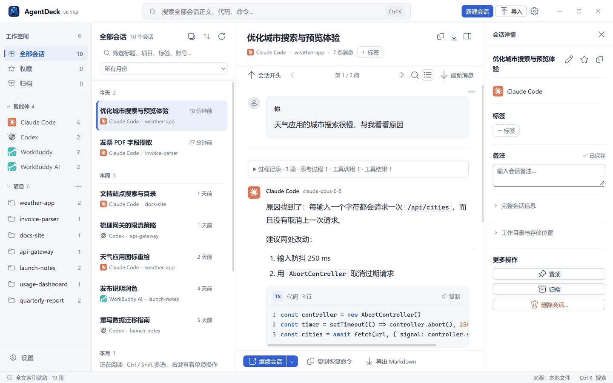
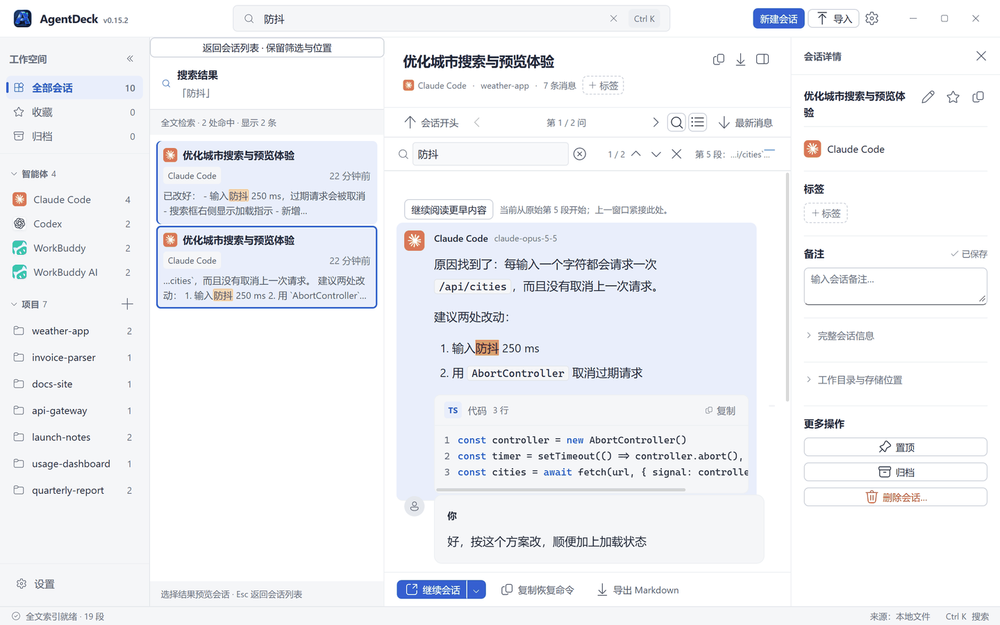
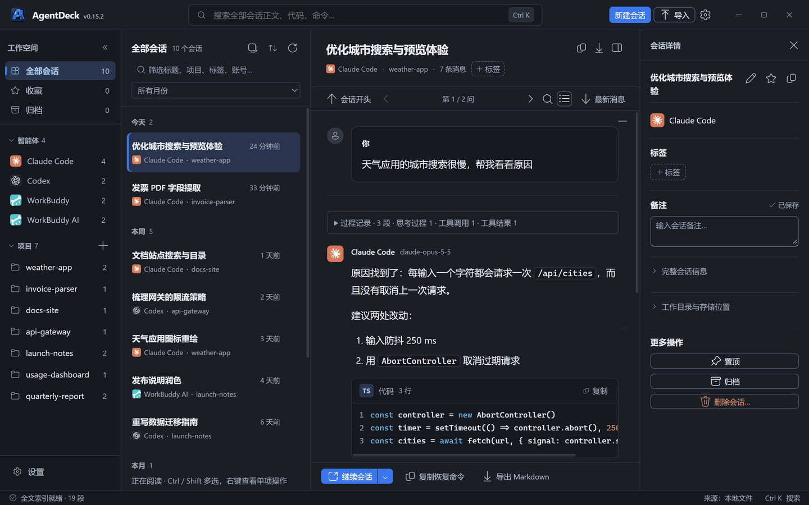
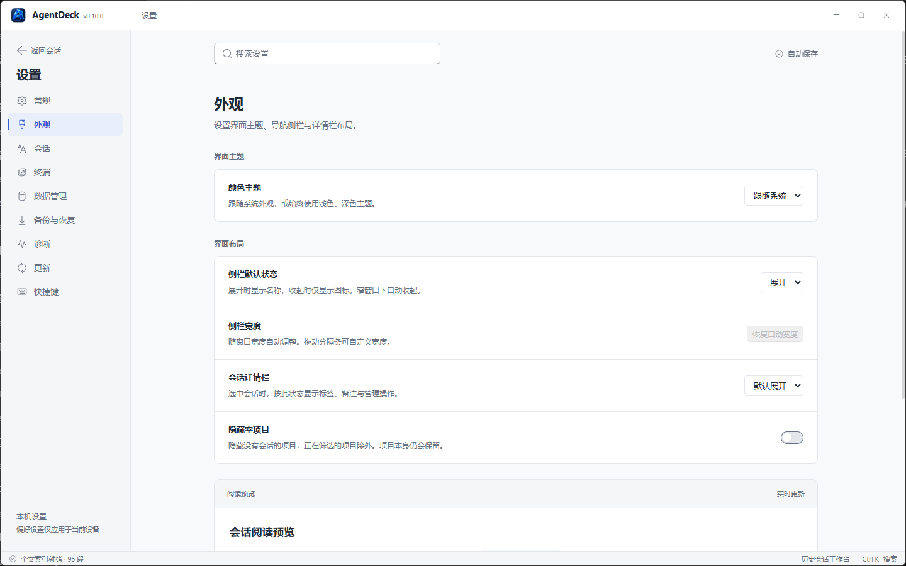
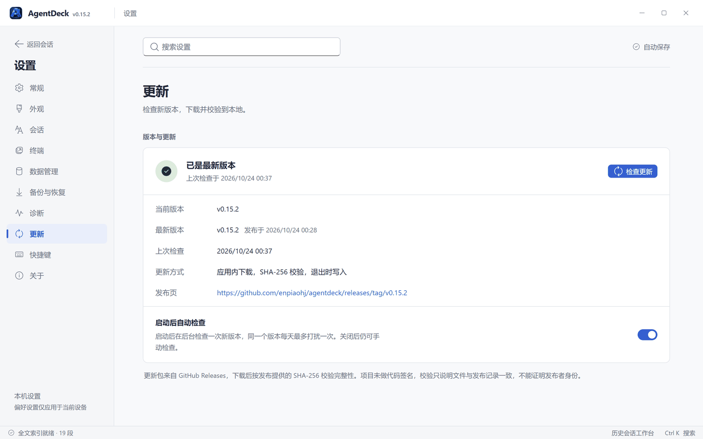

# AgentDeck

[](https://github.com/enpiaohj/agentdeck/releases/latest)
[](LICENSE)


**跨 Agent 的历史会话检索与恢复工作台。** *All your coding agents. One deck.*

统一索引 Claude Code、Claude Desktop、Codex、WorkBuddy 等多个 AI 编程智能体留在本机的历史会话，
做三件事：**找到当时的工作 → 看清做到哪一步 → 在正确的工具和目录里继续。**



> 截图中的会话全部为演示数据。

[下载与安装](#下载与安装) · [快速上手](#快速上手) · [功能](#功能) · [支持的智能体](#支持的智能体与数据来源) ·
[隐私](#隐私与网络访问) · [构建](#构建) · [更新日志](CHANGELOG.md)

## 为什么用它

- **一个入口看所有智能体**：不同工具的会话散在不同目录、不同格式里，这里统一发现、统一阅读。
- **中文全文检索**：SQLite FTS5 + bigram 预分词，两字中文词也能命中，并定位到正文中的那一段。
- **在正确的地方继续**：复制恢复命令，或直接在终端、在对的工作目录里恢复会话；项目目录改名或迁移后也能继续。
- **默认只读、不上传、不遥测**：会话与索引都在本机；手动删除是唯一会写上游的操作，且先预览、先备份。
- **上游清理后仍可读**：成功读取过的会话保留本地副本，不依赖智能体自己的历史保留策略。
- **应用内更新**：下载后按 SHA-256 校验，退出时写入新版本；失败不影响当前版本。

## 下载与安装

Windows x64 版本从 [Releases](https://github.com/enpiaohj/agentdeck/releases/latest) 下载：

| 文件 | 说明 |
| --- | --- |
| `AgentDeck-vX.Y.Z-win-x64.exe` | 单文件绿色版，双击运行 |
| `AgentDeck-vX.Y.Z-win-x64.zip` | 同一 EXE，加 CHANGELOG、`LICENSE`、`NOTICE.md` 与 `THIRD-PARTY-NOTICES.txt` |
| `AgentDeck-vX.Y.Z-source.zip` | 该版本对应的完整源码快照 |
| `SHA256SUMS` | 以上产物的校验值 |

- **运行要求**：Windows x64，已安装 Microsoft Edge WebView2 Runtime（Windows 11 默认自带）。
- **SmartScreen**：发布产物未做代码签名，可能提示未知发布者；请先用 `SHA256SUMS` 核对校验值再运行。
  校验只能说明文件与发布记录一致，不能证明发布者身份。
- **升级**：v0.15.2 起可在「设置 → 更新」检查、下载并重启安装（见[在线更新](#在线更新)）。
  **v0.15.0 / v0.15.1 的应用内更新无法下载新版本**（见 [CHANGELOG](CHANGELOG.md)），
  需要手动下载一次 v0.15.2 或更高版本，数据与设置不受影响。

## 快速上手

1. 运行 EXE。AgentDeck 自动发现本机各智能体的会话并建立索引，首次扫描会显示处理进度。
2. 在左侧按智能体或项目筛选；在顶栏输入关键词做全文搜索（`Ctrl+K`），结果与正文并排展示。
3. 点开一个会话阅读；在阅读区按 `Ctrl+F` 查找当前会话，关键词会在正文里高亮。
4. 点「继续会话」在终端里恢复，或「复制恢复命令」自己执行。需要换个目录继续时，点旁边的下拉箭头。

## 最新版本

**v0.15.3** 修复搜索定位、阅读位置恢复与复制导出反馈：

- **深处命中准确定位**：超长正文从命中附近加载，并把命中所在的代码块与正文滚入视野
- **代码查找高亮**：跨语法高亮节点、连续空白及代码行的关键词可正确标出
- **刷新保留阅读位置**：恢复当前阅读锚点及段内偏移，显式导航优先，避免异步定位把页面拉回旧位置
- **复制与导出反馈**：阅读区复制成功或失败均有提示；Markdown 导出后显示可复制的保存路径，失败时显示原因

各版本的完整变化见 [CHANGELOG.md](CHANGELOG.md)。

## 功能

### 会话发现与阅读

- 自动发现本机各智能体的会话并建立索引，读取原生标题与正文；会话列表头部的刷新按钮
  （或 `F5`）重新扫描磁盘，同时更新列表、项目统计与全文索引
- 紧凑四栏工作台：导航、会话列表、阅读区、会话详情；左右面板可独立折叠，浅色 / 深色主题
- 会话默认定位最新一轮问答；长会话从真实末尾读取，不受开头预览上限遮挡
- **提问导航条**：有多次提问时，阅读区右侧显示一列短刻度，每根刻度对应一次提问，位置按该段在
  全文中的序号成比例。悬停显示「第 k / n 问」与摘要，点击跳转，当前所读的一问用主题色标出；
  相邻标记过近时合并。可在阅读导航栏一键收起并记住偏好。顶部同时显示「第 k / n 问」与上一问 / 下一问箭头
- 思考、工具调用 / 结果、上下文及大段 JSON 默认折叠；长代码按需展开，搜索命中自动展开对应内容
- Markdown 标题、列表、引用、表格、代码块与行内代码排版；会话可导出为 Markdown
- Codex 子 Agent 按已确认的主会话归组，默认折叠，可展开查看；会话计数不重复计入子会话
- Token 与成本统计（含逐模型明细）

### 搜索



- **全局搜索**：顶栏直接输入，结果与正文并排展示；`Ctrl+K` 聚焦、方向键选择、`Enter` 预览、`Esc` 返回列表。
  中文两字词也能命中，并定位到正文中的那一段
- **会话内查找**（`Ctrl+F`）：命中的关键词在正文里高亮（全部命中淡色，当前一处加深）；输入后自动跳到当前位置
  之后的第一处命中，`Enter` / `Shift+Enter` 跳下一 / 上一处；正文里选中了文字时，`Ctrl+F` 直接带入它；
  `Esc` 或 × 收起后回到查找前的阅读位置
- **两者联动**：全局搜索结果里的关键词与会话内查找使用同一种黄底高亮；从结果点进某个会话，
  会带着命中词自动打开会话内查找

### 整理与筛选



- 侧栏只有一个滚动区：「全部会话 / 收藏 / 归档」固定在顶部、「设置」固定在底部，智能体与项目分区可折叠，
  标题滚动时吸顶；项目默认列出前 8 个，可「显示全部」
- 智能体 / 项目 / 收藏 / 归档默认单选（单击替换整个筛选），`Ctrl+单击` 把该维度并入或移出当前筛选；
  智能体可 `Ctrl+单击` 多选、`Shift+单击` 按侧栏顺序连选、`Ctrl+Shift+单击` 把一段并入已选，列表取并集，
  顶部每个智能体一个可移除的标签；「全部会话」清除全部筛选与搜索关键词
- 当前列表支持标题 / 项目 / 标签 / 账号与月份筛选、最近 / 最早活动排序，历史记录按日期与年月分组
- 导航侧栏、会话列表、会话详情栏都可拖动分隔条调整宽度：双击恢复自动宽度，方向键按 8px、
  `Shift+方向键` 按 32px 微调；宽度会记住，且始终给正文区留出阅读空间
- 收藏 / 标签 / 备注 / 归档保存在本地标注库，不改上游文件，按项目维度聚合
- **置顶**：会话可在右键菜单（支持多选）或详情栏「更多操作」中置顶，集中显示在列表最上方的「置顶」分组；
  智能体与项目在侧栏右键菜单中置顶，排在各自分区的最前面。置顶只影响显示顺序，随完整数据备份一起备份
- 会话列表采用桌面选择：单击单选、`Ctrl` 点击切换、`Shift` 连选、`Ctrl+Shift` 追加连选；`Ctrl+A` 全选当前筛选结果，
  `Esc` 清空选择；支持方向键与 `Home` / `End`
- 会话右键菜单支持打开、继续会话、在其他目录继续、收藏、归档、管理标签与备注、复制及 Markdown 导出；
  多选时支持批量整理与导出，`Shift+F10` 可用键盘打开菜单
- 归档、取消归档与批量收藏成功后会提示完成数量并提供「撤销」；批量中部分失败时单独报告失败数量。
  这些操作只更新受影响的行，不会重新载入整个列表
- 本机 WorkBuddy / WorkBuddy AI 会话若在各自数据库中标记为已删除、但文件仍在，仍会列出，以灰色状态图标标出并提供
  悬停说明；其他智能体及 WSL 来源暂不检测此状态

### 继续会话

- 复制恢复命令，或直接在终端中继续会话（仅对支持命令行恢复的智能体）
- **在其他目录继续**：会话右键菜单与「继续会话」旁的下拉箭头提供「在其他目录继续…」。仅本次在所选目录里继续，
  不修改会话记录，也不移动文件；「保存为此项目的位置关联」默认不勾选，不会因一次临时选择悄悄改掉整个项目的映射
- **项目目录不可用时**，可选择现有目录继续会话或复制命令，并选择是否记住新位置。侧栏项目右键菜单提供
  「更改项目位置…」「移除位置关联」和「打开项目目录」。关联按完整路径精确匹配，新建会话和打开目录使用关联位置，
  筛选与置顶保留原项目身份；不移动文件，不修改原始会话记录
- 跨目录恢复的能力取决于对应的命令行工具：Claude 的 `claude --resume <会话ID>` 可在任意目录执行；Codex 会追加 `--cd`；
  Cursor 按目录查找会话，暂不支持跨目录恢复；WSL 恢复保持原有行为。关联目录不代表工具一定能找到原会话
- 终端 PowerShell 可在设置中选择：自动（优先 PowerShell 7+，默认）、Windows PowerShell 5.1、PowerShell 7+ 或自定义
  可执行文件，并显示检测到的版本；已保存的选择保持不变
- 「继续会话时的打开方式」可选「新窗口」（默认）或「新标签」；选「新标签」时在活动的 Windows Terminal 窗口中
  新开一个标签，没有打开的终端窗口时新建一个。未检测到 Windows Terminal 时该选项不可选
- 「继续会话时最大化打开终端」默认关闭；开启后新建终端窗口时以 `-M` 最大化，没有 Windows Terminal 时给新控制台
  窗口 `-WindowStyle Maximized`（由 conhost 托管时生效）。复用已有窗口开标签时不改变该窗口尺寸。
  该选项只作用于继续会话，新建会话仍按普通窗口打开
- Codex 会话在恢复前会同步 AgentDeck 里设置的名称；Codex 自己的索引里已经是同名时跳过同步，不再等待 Codex 的
  app-server 启动
- 恢复参数（会话 ID、工作目录）按白名单校验后才交给终端

### 设置



- 十个分类：常规、外观、会话、终端、数据管理、备份与恢复、诊断、更新、快捷键、关于；支持多关键词搜索，`Ctrl+,` 打开
- 开机启动和关闭时最小化到托盘均默认关闭（见[启动与系统托盘](#启动与系统托盘)）

## 支持的智能体与数据来源

AgentDeck 默认只读访问各智能体的本地存储。唯一例外是**用户显式发起的手动删除**（见[删除会话](#删除会话)）：
只有经过预览确认、且备份成功之后才会写入。

| 智能体 | 存储位置 |
| --- | --- |
| Claude Code CLI | `~/.claude/projects/<编码目录>/*.jsonl` |
| Claude Desktop（Code / Cowork） | `%LOCALAPPDATA%\Claude-Data\claude_<pub>\{local-agent-mode-sessions,claude-code-sessions}\...\.claude\projects\`（3.x；2.x 在 `Packages\Claude_<pub>\LocalCache\Roaming\Claude`） |
| Claude Desktop（聊天缓存） | `%LOCALAPPDATA%\Claude-Data\claude_<pub>\IndexedDB\https_claude.ai_0.indexeddb.{leveldb,blob}` |
| Codex | `~/.codex/sessions/YYYY/MM/DD/rollout-*.jsonl` + `state_5.sqlite` |
| WorkBuddy / WorkBuddy AI（国际版） | `~/.workbuddy/projects/`、`~/.workbuddy-ai/projects/` 下的 `*.jsonl`；删除状态只读自各自的 `workbuddy.db` |
| OpenCode | `~/.local/share/opencode/opencode.db` |
| ZCode | `~/.zcode/cli/db/db.sqlite` |
| DeepSeek Harness (dsh) | `~/.dsh/sessions/<编码目录>/<会话>/session.v<N>.jsonl[.zstd]` |

此外还会发现 Hermes、Qoder / Qoder CN、Cursor、Cline、Grok、Kimi、Pi、Droid、Alma、CodeBuddy 等智能体的本地记录，
以本机实际安装为准。

<details>
<summary><b>Claude Desktop 的聊天与导入</b></summary>

Claude Desktop 读取本地 Code / Cowork 记录（含 MSIX 目录），以及 Desktop 本机缓存的普通聊天与项目会话
（来源显示「Desktop 聊天缓存」）：Desktop 不为云端聊天写本地记录，只有在 Desktop 里打开过的会话才缓存了正文。
AgentDeck 只读这份缓存，副本存在导入目录旁的 `claude-desktop-cache/`；这类会话不能恢复或删除原始记录。

没打开过的会话与更早的聊天请使用顶部「导入」：从各 Claude 账号的「设置 → 隐私 → 导出数据」下载 ZIP，或选择其中的
`conversations.json`。同一账号沿用同一名称；不同账号使用不同名称。导入副本保存在索引库旁的 `imports/claude/`，
原始文件不变，云端不会自动同步。当前导入文本与思考内容，不包含附件文件本体、图片及部分工具内容，不能通过 CLI 恢复导入会话。

</details>

## 本地会话库、备份与数据位置

本地会话库默认位于 `%LOCALAPPDATA%\AgentDeck\library\history.db`，与可重建的 `index.db` 分开。启动或刷新后构建索引、
打开正文、导出等读取会自动保存可解析内容；新内容作为版本保留，没有过期时间和自动删除任务。保留库保存解析器读到的完整正文，
不沿用界面预览的截断上限；附件文件本体仍不在范围内。上游已丢失且从未读入的内容无法补回。源记录消失后的本地副本保持原会话标识、
收藏、标签和备注，不宣称可以原生恢复。

- **数据管理**：「设置 → 数据管理」可查看库位置、会话数、版本数及保存错误，并压缩会话库、清理旧版本、迁移数据位置。
- **备份与恢复**：「设置 → 备份与恢复」创建完整数据备份，包含本地会话库全部版本、收藏 / 归档 / 标签 / 备注、导入历史及界面偏好；
  不包含原生智能体目录、账号凭据和附件文件，全文索引可重建。
- **数据位置**可整体迁移到其他磁盘，旧位置的数据一律保留，确认新位置运行正常后再显式清理。

<details>
<summary><b>压缩与清理旧版本</b></summary>

正文按 zstd 存放（小于 4 KiB 不压），内容与元数据都没变时不再重写；升级前留下的明文正文可用「设置 → 数据管理 → 压缩会话库」
重压一遍并回收文件空间，原始内容不变、可重复执行。全文索引的 FTS 表只留一份分词结果（contentless），旧索引在首次打开时就地重建该表，
不重读会话文件。

会话持续进行时，每次读取到新内容都会保存一份完整快照，同一个会话可以累积上百个版本。「设置 → 数据管理 → 清理旧版本」让你指定每个会话
保留最新几个版本（默认 5），先预览会清掉多少版本、释放多少空间，勾选确认后才执行。每个会话当前使用的版本始终保留，阅读、搜索与导出
不受影响；候选集的计算与删除在同一个事务里，之后回收文件空间。这是本地会话库里唯一会删除版本的操作，被清理的版本无法恢复——需要保险
可先在「备份与恢复」创建完整备份。

</details>

<details>
<summary><b>备份与恢复的细节</b></summary>

单个备份上限为 20,000 个数据文件、解压后 4 GiB。恢复前校验格式、文件清单、SHA256 和数据库内容，并在本地会话库目录下的 `data-recovery/`
自动保存当前完整备份。恢复采用合并方式，保留现有正文及版本，同名会话标注以备份为准，导入文件冲突时拒绝覆盖。每个数据库独立提交事务；
异常时可能已补入部分历史，但不会删除已有版本，界面会显示恢复前备份的位置。恢复后自动重新构建全文索引。

</details>

<details>
<summary><b>迁移数据位置的规则</b></summary>

选择的是「数据放在哪个目录下」：数据根固定取所选目录下的 `AgentDeck\Data`（例如，选择 `D:\` 得到 `D:\AgentDeck\Data`，`D:\software`
得到 `D:\software\AgentDeck\Data`）；所选目录本身就叫 `AgentDeck` 时只追加 `Data`，已经选到数据根本身时原样使用；只比末级目录名，
不做前缀匹配。确认之前界面即显示补全后的路径与目标现状——已存在且为空可直接使用，已存在且非空则拒绝，不存在则迁移时创建。

迁移对三个数据库取在线一致快照（`VACUUM INTO`），其余数据文件逐个复制并校验 SHA-256，全部通过后才写入位置指针，重启后生效。
旧位置的数据一律保留，确认新位置运行正常后再用「清理旧位置数据」显式删除（预览清单绑定内容哈希，内容变化则整批拒绝）。
全文索引可重建，不参与复制，重启后按新位置重建。位置指针保存在 `%APPDATA%\AgentDeck\app-config.json`，该文件始终留在原地，
迁移与清理都不会动它。

</details>

## 在线更新

「设置 → 更新」显示当前版本与状态，可手动检查更新；启动后会在后台检查一次（同一版本每天最多一次，可关闭「启动后自动检查」）。



1. **下载并更新**：把发布里那一个 EXE 下到数据目录的 `updates/`，按发布随附的 SHA-256（资产自带的 `digest`，旧版发布回退到 `SHA256SUMS`）
   与文件大小双重校验。下载中可以「取消下载」。
2. **重启并安装**（会先弹一次确认）：AgentDeck 关闭数据库、释放单实例锁之后才写入新版本，然后重新打开。
   也可以直接退出——更新会在退出时写入，并把开机启动项与快捷方式改指向新文件，下次启动即为新版本。
   开启「关闭到托盘」时点 × 只是隐藏，不会写入。

<details>
<summary><b>下载与落地的细节</b></summary>

- **只下载一个 EXE**，不经 ZIP 中转：发布里 EXE 与 ZIP 是两个内容不同的资产，早先按 ZIP 的哈希校验 EXE 的写法会让每一次应用内更新都在下载
  完成后被丢弃（v0.15.0 / v0.15.1 即如此）。
- **慢链路不被误杀**：下载不设整次请求的短总超时，只设「45 秒没有任何数据」的停滞看门狗；整次下载的兜底上限为 30 分钟。
- **断点续传与复用**：中断后保留 `.part`，再次下载用 Range 从断点继续，最终仍对整个文件做 SHA-256；同名安装包已下载且校验通过时直接复用；
  其他版本遗留的安装包会被清理；取消或校验失败不留半成品。
- **检查结论连同资产地址一起落盘**，「检查过之后当天再打开应用」也能直接下载。有更新的版本、但发布里暂时没有可下载文件时，
  界面显示「发现新版本」并提示到发布页查看，不会显示成「已是最新版本」。
- **落地时机放在进程退出的最后一步**：正在运行的 EXE 不能被覆盖。
- **文件名跟随版本**：当前文件是发布产物命名（如 `AgentDeck-v0.15.2-win-x64.exe`）时，新版本以它自己的产物名写到同一目录，开机启动项与桌面 /
  开始菜单 / 任务栏快捷方式自动改指向新文件；文件名被改过（如 `AgentDeck.exe`）时原地替换，不改动用户起的名字。
- **失败不影响当前版本**：新文件先写成 `.new` 临时名并核对大小才改名到位，落地失败时原文件保持可用，并在下次启动提示一次。
- **回滚副本**叫 `<程序名>.agentdeck-backup`，下次启动即清掉；刻意不用 `.old`，因为那个名字更可能是用户自己的备份，更新流程不应认领它。
- **善后只在确认启动项与快捷方式都已改指向之后才删除旧文件**；改指向没确认就留着旧文件，宁可多留一个文件，也不留下点不开的死链接。
- 程序所在目录不可写（例如装在 `Program Files`）时会在下载阶段直接报错，不会等到退出才失败；请把 AgentDeck 移到有写入权限的目录，
  或到发布页手动下载。通过 `go run` 或测试二进制启动时无法在应用内安装，界面直接给出「到发布页下载」。

</details>

## 快捷键

| 操作 | 快捷键 |
| --- | --- |
| 搜索所有会话 | `Ctrl+K` |
| 刷新会话列表 | `F5` |
| 新建会话 / 新建项目 | `Ctrl+N` / `Ctrl+Shift+N` |
| 打开设置 | `Ctrl+,` |
| 查找当前会话 | `Ctrl+F`（`Enter` / `Shift+Enter` 跳到下一 / 上一处） |
| 全选当前列表 / 清空选择 | `Ctrl+A` / `Esc` |
| 追加 / 取消选择、连续选择 | `Ctrl+单击`、`Shift+单击`、`Ctrl+Shift+单击` |
| 多选 / 连选智能体（侧栏） | `Ctrl+单击` / `Shift+单击` |
| 重命名 / 删除所选会话 | `F2` / `Delete`（删除先显示确认窗口） |
| 打开操作菜单 | `Shift+F10` / 菜单键 |
| 调整栏宽 | 拖动分隔条；聚焦后 `←` / `→` 移 8px，`Shift+←` / `→` 移 32px；双击恢复自动宽度 |
| 保存备注 | `Ctrl+Enter` |

完整列表见「设置 → 快捷键」。

## 启动与系统托盘

在「设置 → 常规 → 启动与退出」分别设置开机启动和关闭时最小化到托盘，两项默认关闭。开机启动时主窗口保持隐藏；手动打开程序、
单击托盘图标或选择「打开 AgentDeck」会显示窗口。启用关闭到托盘后，使用托盘菜单「退出」结束应用；未启用时关闭窗口即退出。

开机启动使用当前用户的 Windows 启动注册项，记录启用时的程序绝对路径。建议将正式 EXE 放在固定目录后再启用；移动或更换 EXE 路径后，
在新程序中关闭并重新开启开机启动以更新路径。窗口关闭偏好保存在 `%APPDATA%\AgentDeck\app-config.json`，旧配置缺少新字段时均按关闭处理。

## 隐私与网络访问

- 会话正文、索引、标注与偏好全部保存在本机，**不上传、不遥测、不需要账号**。
- 不读取独立的账号凭据文件或 Cookie 存储。Desktop 聊天缓存功能只读扫描本机缓存，从中提取会话正文、列表元数据、账号标识与显示名，
  并读取本地授权文件夹映射以确定工作目录；不使用这些信息进行登录或认证。
- 当前应用从本机缓存与内置目录读取模型和定价信息，尚未接入模型目录的联网刷新入口。
- **唯一的对外请求是检查更新**：向 `https://api.github.com/repos/enpiaohj/agentdeck/releases/latest` 发起一次只读 GET，User-Agent
  只含产品名与版本号，不发送会话、路径或账号信息。启动后的自动检查同一版本每天最多一次，结果缓存在数据目录的 `updates/check.json`；
  关闭「启动后自动检查」后不再发起该请求。下载只在你点击「下载并更新」时发生。
- 返回的下载地址必须是 `github.com` 的 https 地址，否则不提示有新版本。
- 联网时按环境变量代理（`HTTPS_PROXY` 等）走；环境里没有时读取 Windows 系统代理（手动设置的 HTTP 代理，含「系统代理」模式的代理工具；
  不支持自动配置脚本 PAC 与 socks 代理，按直连处理）。
- 更新包的校验只能说明文件与发布记录一致，不能证明发布者身份（项目未做代码签名）。
- 写入新版本只在本程序退出时、且只针对本程序自己的 EXE 与其所在目录；不会启动更新包中的任何其他程序。
- 诊断界面显示本机扫描与读取错误，错误信息可能包含本机路径；分享诊断信息前请检查其中的个人信息。

## 安全与依赖维护

- **每次发布前的检查**：`govulncheck` 检查 Go 依赖与标准库中会被实际调用的漏洞，`npm audit` 检查前端依赖，两者都为 0 项才发布；
  GitHub Dependabot 持续监控依赖告警。
- **固定构建工具链**：`go.mod` 用 `toolchain` 指定 Go 版本（当前 1.27.3），不同机器构建出的程序使用同一套标准库，不受各自安装的 Go 版本影响。
- **依赖升级的原则**：安全修复优先，以 PATCH 版本发布；常规升级逐项验证，改变行为的升级（例如改变报错格式、需要重新生成绑定或更换打包器）
  单独评估，不为通过测试而放宽断言。
- **仓库里重复的告警**：`releases/` 下每个已发布版本的源码快照都包含 `go.mod` 与 `package-lock.json`，GitHub 会按快照数量重复报告同一批问题。
  快照是不可变的发布记录，不参与构建，这类告警会被驳回，针对快照目录的 Dependabot PR 不会合并；当前代码的告警通过升级依赖解决。
- **报告漏洞**：请按 [SECURITY.md](SECURITY.md) 私下报告，不要使用公开 Issue。

## 删除会话

删除是**不可自动回滚**的破坏性操作，因此设计成四道闸：

1. **只对明确来源开放**：仅本机原生或永久保留的 Codex、Claude Code、Claude Desktop 会话。WSL、网关、导入与聊天缓存来源一律拒绝并给出原因
   （在 WSL 里管理、副本不可原生恢复）。
2. **执行前重新校验**：预览会核对文件路径、大小与内容；源文件若在预览后发生变化，整批拒绝并要求重新预览。
3. **先备份再删**：删除前把原始文件与 AgentDeck 保留的全部版本写入 `%LOCALAPPDATA%\AgentDeck\deletions\delete-*\`，备份失败则一个字节都不删。
   备份只含所选会话：原始文件逐个复制，保留版本与标注按会话复制成独立的小库，不复制整库，所以删除耗时与会话库大小无关。多个来源中途失败时，已删的部分会回滚。
4. **不删目录**：只移除确认过的具体文件与索引条目，不递归删除目录。

删除时会同步处理相关会话索引；遇到无法识别的数据库结构时拒绝操作。撤销仅在本次运行期间提供，磁盘上的备份长期保留。

<details>
<summary><b>「删除前创建恢复备份」开关</b></summary>

删除对话框只有「取消」与「删除」两个按钮。是否在删除前保留恢复备份，由「设置 → 会话 → 删除会话 → 删除前创建恢复备份」决定，默认开启：

- **开启（默认）**：删除后提示条提供「撤销删除」，备份长期保留在磁盘上。对话框不要求额外勾选。
- **关闭**：对话框以醒目样式说明「删除后无法恢复」，需勾选「我了解此操作无法撤销」后才能删除。适合不希望在磁盘上留下这些会话私密副本的场景。

关闭后**不是跳过备份**：恢复备份仍然先写、先校验，因为删除中途失败时的自动回滚完全依赖它；预览、来源限制、内容哈希校验、不删目录这几道闸一样不少。
区别只在删除全部成功之后：备份文件逐个删除（目录只用非递归方式收掉），不提供撤销。只会留下一个只含会话标识、不含内容的 `operation.json`，
用来防止已删会话被其他来源重新收录。

</details>

## 架构

```
cmd/agentdeck/         命令行入口
cmd/agentdeck-desktop/ Wails 桌面入口
frontend/              React 桌面界面与生成的服务 bindings
internal/app/          桌面服务层与装配
internal/appconfig/    数据位置与终端设置的引导配置
internal/search/       中文全文索引与检索
internal/marks/        本地收藏、标签、备注与归档
internal/projects/     项目聚合与路径归一化
internal/sessions/     会话发现、解析、列表、恢复（核心）
internal/catalog/      模型目录与定价数据
internal/redact/       脱敏
internal/settings/     设置
internal/desktopdir/   Claude Desktop 目录发现（含 MSIX 打包路径与 3.x 新数据目录）
internal/claudecache/  Claude Desktop 本机聊天缓存（IndexedDB）只读解析
internal/claudehistory/ Claude 官方导出（JSON / ZIP）导入
internal/update/       在线更新检查、下载与校验（含系统代理、断点续传）
internal/updateinstall/ 更新包在退出时落地（临时名、回滚、启动项与快捷方式改指向）
internal/provider/     最小 provider 替代（只读打开 + 基础定价）
tools/                 图标与第三方许可声明生成脚本
```

技术栈：Go · Wails v3 · React 18 · Fluent UI v9 · SQLite（`modernc.org/sqlite`，纯 Go，无 CGO）。会话层不依赖任何桌面框架，可独立编译与测试。

## 构建

要求 Go 1.26.8 或更高；`go.mod` 用 `toolchain go1.27.3` 固定构建工具链，本机版本较低时 `go` 会自动下载该版本（需要网络，或预先安装）。
桌面构建另需 Node.js / npm、Wails CLI `wails3`（与 `go.mod` 中的 `v3.0.0-beta.30` 对齐）、Task 和 PowerShell 7（`pwsh`），运行时需要 WebView2。

命令行与 Go 编译检查：

```sh
go build ./...
go run ./cmd/agentdeck
```

Windows 桌面完整构建（生成 bindings → 构建前端 → 清理并同步资源 → 编译 exe）：

```powershell
task build
```

输出为 `bin/agentdeck-desktop.exe`。已有依赖与 bindings 时，可分步构建：

```powershell
Set-Location frontend
npm run build
Set-Location ..
pwsh -NoProfile -File frontend/scripts/sync-assets.ps1
go build -trimpath -tags production -ldflags "-H windowsgui -s -w" -o bin/agentdeck-desktop.exe ./cmd/agentdeck-desktop
```

资源同步会清空打包目录中的旧生成文件（只保留 `.gitkeep`），再复制 `frontend/dist`，并校验两者的文件清单完全一致；只运行 `go build` 不会刷新前端。
`frontend/scripts/rebuild.ps1` 还会重启应用并截图。

验证命令：

```powershell
gofmt -l cmd internal
go vet ./...
go build ./...
go test ./... -count=1
go run golang.org/x/vuln/cmd/govulncheck@v1.1.4 ./...   # 依赖与标准库漏洞
```

前端：在 `frontend/` 运行 `npm test`（使用 Node.js 22 验证）与 `npm audit`。

## 已知限制

- 关闭「删除前创建恢复备份」后的删除、以及「清理旧版本」都不可撤销。
- 上游智能体可能自动清理历史记录；AgentDeck 保留成功读取的本地副本，但无法补回首次读取前已删除的记录。
- Claude Desktop 会话无原生恢复入口；Desktop 聊天缓存只包含在 Desktop 里打开过的会话，其缓存格式属于 claude.ai 前端的内部结构，
  Desktop 升级后可能变化（读取失败会显示在诊断里）。
- 会话内查找按原始 Markdown 文本的子串匹配；超长段落采用命中附近的 8000 字符窗口，中部窗口可能缺少围栏而影响 Markdown 排版。
- 当前正式产物为未签名的 Windows x64 单文件 EXE，尚无安装包。
- 原生窗口在不同 DPI 下尚未完整走查，macOS / Linux 尚未构建和运行验证。
- 「在其他目录继续」对 opencode、pi、cline、kimi 等智能体的跨目录行为尚未逐一验证。

## 路线图

- 生成新摘要、交接到其他 Agent
- 项目 / 文件 / 工具调用独立视图

## 许可

MIT。包含移植自 [magpie](https://github.com/yetone/magpie) 的代码（MIT, Copyright (c) 2026 yetone）与
[Lobe Icons](https://github.com/lobehub/lobe-icons) 的图标（MIT, Copyright (c) 2023 LobeHub）。依赖许可文本见
[NOTICE.md](NOTICE.md) 与 [THIRD-PARTY-NOTICES.txt](THIRD-PARTY-NOTICES.txt)。品牌名称与标识归各自权利人所有，
本项目与这些产品没有隶属或赞助关系。
